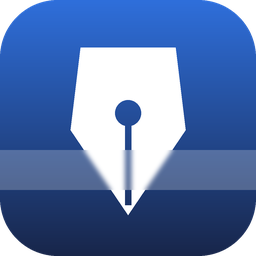

# Inkveil

Inkveil is a note-taking app for Windows that keeps your notes on your own computer, encrypted
under your password. There are no accounts, no sync and no telemetry. The only time it goes
online is when you use the optional AI rewrite and click it yourself.

The window is excluded from screen capture, so screen sharing, OBS, the Snipping Tool and Windows
Recall see a blank rectangle where your notes are.

It is written in Rust on [GPUI](https://www.gpui.rs), the UI framework behind the Zed editor.
There is no web view and no JavaScript.

> [!NOTE]
> Inkveil is in early development. Windows only for now; macOS and Linux are planned. Until 1.0,
> keep another copy of anything you cannot afford to lose.

## Features

- Everything in the vault is encrypted with XChaCha20-Poly1305: titles, tags, note text,
  pictures, settings. The key comes from your password through Argon2id.
- You unlock with your password (at least 8 characters, including a number) or with the
  recovery key Inkveil shows once at setup, for you to write down or print. After 15 wrong attempts in a row, unlocking pauses
  for 30 seconds, growing to at most 15 minutes, and restarting the app does not reset it.
  Windows Hello unlock is planned.
- Edits are saved within about a second, in one SQLite transaction, and "Saved" only shows once
  the write is confirmed. A crash or power cut does not corrupt notes, and reopening brings back
  your tabs and cursor.
- Earlier versions of each note are kept, every few minutes while you edit and thinned to one a
  day later on. The clock icon lets you preview an old version and restore it (Ctrl+Z undoes the
  restore).
- The vault locks itself after 1, 5, 15 or 30 minutes, or 1 or 4 hours, without input (or never),
  and when Windows locks or the PC goes to sleep.
- Pictures can be pasted (Ctrl+V), dropped onto a note or added with Insert > Image. Inkveil
  re-encodes each one, which drops location and camera metadata, shrinks very large ones, and
  stores them encrypted in the vault. Click a picture to see it large, right-click it to copy,
  save, resize, align or delete it, or drag its corner to resize it.
- Find and replace inside a note (Ctrl+F, Ctrl+H) with match case and whole word. The bar shows
  where you are ("2 of 7"), and Replace all is a single Ctrl+Z to undo. The sidebar search looks
  through the full text of every note without writing an index to disk.
- Editing works like VS Code: multiple carets, column selection, Ctrl+D to duplicate a line.
  Headings, lists, checklists, tables, quotes, code and links are all there.
- Spellcheck runs offline (US English), with suggestions and a personal dictionary.

[SECURITY.md](SECURITY.md) has the threat model: what Inkveil protects against and what it
cannot. The latest review is in [docs/SECURITY-AUDIT.md](docs/SECURITY-AUDIT.md).

## Backups

Inkveil makes an encrypted backup of the vault when you unlock it, at most about once a day. It
keeps the 7 newest, one for each of the last 7 days, and one a week for the 4 weeks before
that. These sit next to the vault, on the same disk.

To survive a dead disk or a lost laptop, open Settings, go to Backups and pick a folder somewhere
else: another drive, a USB stick, or a OneDrive or Google Drive folder. Each day's backup is
then copied there too, checked after copying, and rotated the same way. "Back up now" makes one
straight away. The copies open only with your password or recovery key, and the folder gets a
`How to restore.txt` that explains how to use one.

## Where your notes are

> [!WARNING]
> Everything you keep in Inkveil (notes, pictures, settings, your OpenRouter API key) is in
> `%LOCALAPPDATA%\Inkveil\vault`. Read this before you delete, move or clean up anything there.

- Do not delete, move or "clean up" the vault folder, and keep sync, backup and cleanup tools
  from rewriting it. `vault.db` and `vault.db-wal` belong together; the `-wal` file holds your
  most recent saves.
- The `update-backups` and `*-archived-*` folders next to the vault are safety copies. Keep them.
- Installing, updating and uninstalling never touch the vault. Before each update,
  `scripts\install.ps1` closes Inkveil (which saves every note), copies the vault to
  `%LOCALAPPDATA%\Inkveil\update-backups\vault-<date>-<time>` and checks the copy before it
  replaces the program. The last five copies are kept.
- Your password and recovery key are not stored anywhere. Without one of them, nobody can open
  the vault or any of its backups, you included.
- If Inkveil ever offers to create a new vault while you have notes, don't. It means `vault.db`
  is missing. Inkveil refuses to create a vault in a folder that still has your key header or
  backups, and tells you how to put the database back. Restore all the files from the newest
  `update-backups` folder, not `vault.db` on its own.

## AI rewriting (optional)

Select some text and click Improve or Humanize, or find both in the right-click menu. Improve
fixes grammar and smooths the wording. Humanize rewrites more freely, in plain words and keyboard
punctuation, so it reads like something you typed. Invisible characters in the reply (zero-width
spaces, tag characters and the like) are removed; emoji keep theirs. You see the suggestion with
the changed words highlighted, and your note only changes when you click Replace, which Ctrl+Z
undoes.

You need your own [OpenRouter](https://openrouter.ai) API key. Inkveil stores it encrypted in the
vault. In the AI settings you pick a model from the list or type any OpenRouter model id, and
choose how long the model reasons before answering. The efforts on offer depend on the model.

Only the selected text is sent, and only after a check for keys, passwords and other secrets in
it. Requests ask OpenRouter to route only to providers that do not store or train on prompts.
After that, the text is covered by OpenRouter's and the model provider's policies, not Inkveil's.

While the model works, a progress bar shows whether it is waiting, thinking or writing, along
with the seconds so far and a Stop button. If the model goes silent for a minute, the connection
drops, or the provider is busy or rate limited, Inkveil tries again up to three times and says so
("Retrying 1 of 3"). A wrong key, no credits or an unknown model stop at once with a message and
a Try again button. Each attempt gets 3 minutes, 5 at High and 10 at Extra high or Max.

Humanize changes wording, not facts. It cannot remove a statistical watermark that a provider
might build into its choice of words.

## Installing

There are no prebuilt downloads yet, so you build it yourself (see below) and install it with:

```powershell
.\scripts\install.ps1
```

This builds a release version and installs it for your user account in
`%LOCALAPPDATA%\Programs\Inkveil`, with a Start menu entry and a desktop shortcut. It needs no
administrator rights. Run it again to update, or with `-Uninstall` to remove the program (your
notes stay). The build is not code-signed yet, so your antivirus or SmartScreen may ask about it
the first time.

## Building from source

You need Rust 1.99 or newer (rustup picks the right version from `rust-toolchain.toml`) and the
Visual Studio C++ build tools with the "Desktop development with C++" workload, which includes
the Windows SDK.

```powershell
cargo build --release
cargo test --workspace
```

`.\start-dev.ps1 -TestVault` runs a debug build against a throwaway vault in `target\dev-vault`.
Without `-TestVault` it opens your real vault, so keep the flag on while you develop.
`.\scripts\release.ps1` builds a release and signs it if you give it a certificate; see
[docs/RELEASING.md](docs/RELEASING.md).

Before sending a change, read [AGENTS.md](AGENTS.md) (it applies to people and AI coding agents
alike) and make sure these pass:

```powershell
cargo fmt --all -- --check
cargo clippy --workspace --all-targets
cargo test --workspace
```

## Keyboard shortcuts

| Action | Keys |
|---|---|
| New note | Ctrl+N, or double-click empty space in the tab bar or note list |
| Close tab / next / previous | Ctrl+W / Ctrl+Tab / Ctrl+Shift+Tab |
| Search all notes | Ctrl+P or Ctrl+Shift+F |
| Find / replace in the note | Ctrl+F / Ctrl+H (Enter / Shift+Enter: next / previous, F3) |
| Duplicate line | Ctrl+D or Shift+Alt+Down |
| Add caret | Ctrl+click or Alt+click; Ctrl+Alt+Up / Down |
| Caret on every line down to where you click (column select) | Shift+Alt+click or Shift+Alt+drag |
| Caret at the end of every selected line | Shift+Alt+I |
| Back to one caret | Escape |
| Autoscroll, like in a browser | Click the mouse wheel and move; click again or Escape to stop |
| Lock now | Ctrl+L |
| Bold, italic, underline, strikethrough, code | Ctrl+B, Ctrl+I, Ctrl+U, Ctrl+Shift+X, Ctrl+E |
| Link | Ctrl+K |
| Heading 1, 2, 3 / paragraph | Ctrl+Alt+1, 2, 3 / Ctrl+Alt+0 |
| Lists while typing | `- `, `1. `, `[] `, `# `, `> ` at the start of a line |
| Indent / outdent | Tab / Shift+Tab (in tables: next / previous cell) |
| Word wrap / line numbers | Alt+Z / Alt+N |
| Undo / redo | Ctrl+Z / Ctrl+Y |

Right-click in a note for spelling suggestions, the clipboard, the AI rewrites, and table rows
and columns.

## Project layout

| Crate | What it does |
|---|---|
| `inkveil-crypto` | Keys, Argon2id, XChaCha20-Poly1305, recovery keys |
| `inkveil-store` | The encrypted, crash-safe vault on SQLite |
| `inkveil-doc` | Rich-text document model, editing commands, undo history |
| `inkveil-platform` | Capture exclusion, process hardening, private clipboard (Windows) |
| `inkveil-spell` | Offline spellcheck with a bundled en-US Hunspell dictionary |
| `inkveil-app` | The desktop app itself |

[docs/ARCHITECTURE.md](docs/ARCHITECTURE.md) explains how they fit together.

## Reporting security problems

Please use GitHub's "Report a vulnerability" button on this repository instead of opening a
public issue. More in [SECURITY.md](SECURITY.md).

## Credits

The spellcheck dictionary is `dictionary-en` from
[wooorm/dictionaries](https://github.com/wooorm/dictionaries) (MIT and BSD, based on SCOWL); its
licence is in `crates/inkveil-spell/dictionaries/LICENSE-dictionary-en.txt`. Icons are from
[Lucide](https://lucide.dev) (ISC).

## License

Licensed under either of [Apache License 2.0](LICENSE-APACHE) or [MIT license](LICENSE-MIT) at
your option.

Unless you explicitly state otherwise, any contribution intentionally submitted for inclusion in
this project by you, as defined in the Apache-2.0 license, shall be dual licensed as above,
without any additional terms or conditions.
